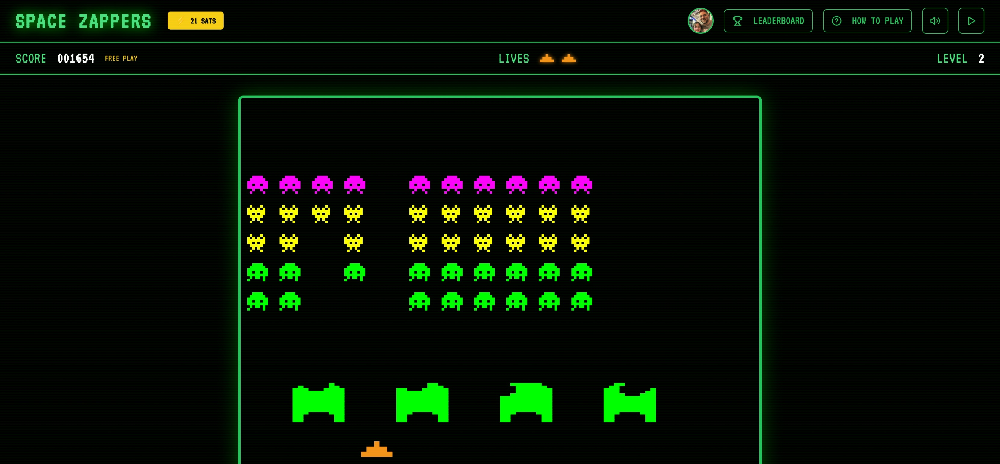

# Space Zappers

A retro Space Invaders arcade game powered by Bitcoin Lightning and Nostr.

Pay 21 sats to play. Publish your high scores to the decentralized leaderboard.



## Features

- **Classic Arcade Gameplay** - Authentic Space Invaders mechanics with pixel art graphics and CRT screen effects
- **Lightning Payments** - Pay 21 sats per game via any Lightning wallet
- **Nostr Leaderboard** - Scores published to Nostr for a censorship-resistant, decentralized high score table
- **Retro Audio** - Chiptune-style music that speeds up as you eliminate invaders
- **Free Play Mode** - Try the game without paying (scores not publishable)

## How to Play

1. **Pay to Play** - Click "Pay 21 Sats" and scan the QR code with your Lightning wallet
2. **Move** - Arrow keys (← →) or A/D
3. **Shoot** - Spacebar
4. **Survive** - Destroy all invaders before they reach you
5. **Compete** - Login with Nostr to publish your score to the global leaderboard

## Tech Stack

- React 18 + TypeScript + Vite
- TailwindCSS + shadcn/ui
- Nostrify (Nostr protocol)
- LNbits (Lightning payments)
- HTML5 Canvas (game rendering)

## Development

```bash
# Install dependencies
npm install

# Start development server
npm run dev

# Run tests and build
npm run test

# Production build
npm run build

# Deploy to Nostr
npm run deploy
```

## Lightning Payment Flow

1. The game calls `POST /api/invoice` on the score service (same origin, proxied by the container's nginx)
2. The score service creates the invoice on the game's LNbits wallet using `LNBITS_INVOICE_KEY`, which never leaves the server
3. User pays with any Lightning wallet (or one-click via NWC / WebLN)
4. The game polls `GET /api/invoice/<payment_hash>`; the score service checks LNbits and returns only `{ "paid": true|false }`
5. Game detects payment and starts automatically

The browser never holds an LNbits key: an invoice key exposes the wallet's balance and payment history, so it must stay server-side. `POST /api/invoice` is public, so the service only accepts the game price (`INVOICE_MIN_SATS`..`INVOICE_MAX_SATS`, default exactly 21), sets the memo itself, throttles per client IP (IPv6 per /64) and globally, and only answers status checks for invoices it issued. The response includes `expiresAt`, and the game polls until then.

[WEBHOOK.md](./WEBHOOK.md) and [SETUP_PAYMENT_DETECTION.md](./SETUP_PAYMENT_DETECTION.md) are superseded: they describe an older webhook + Nostr (kind 8550) design that the current game does not use.

See [TROUBLESHOOTING.adoc](./docs/TROUBLESHOOTING.adoc) for known issues and solutions.

### Wallet Connection (NWC)

Players can connect a Lightning wallet via [Nostr Wallet Connect (NWC)](https://nwc.dev) for one-click payments. The connection is stored in localStorage and persists across browser sessions until manually disconnected.

## Nostr Integration

Space Zappers uses the [Gamestr](https://gamestr.io) protocol for decentralized leaderboards.

### Event Kinds

| Kind | Purpose |
|------|---------|
| 30762 | Game scores ([Gamestr spec](https://gamestr.io/developers)) |

### Architecture

```
┌─────────────────┐     ┌──────────────────┐     ┌─────────────────┐
│   Game Client   │────▶│  Score Service   │────▶│  Nostr Relays   │
│   (Browser)     │     │  (signs scores)  │     │                 │
└─────────────────┘     └──────────────────┘     └─────────────────┘
        │                       │
        │                       │ GAME_NSEC (private)
        ▼                       ▼
   Player pubkey          Game pubkey signs
   identifies user        score events
```

The score service holds the game's private key (nsec) and signs score events on behalf of players. This prevents score spoofing since only the game can publish valid scores.

### Querying Scores

```javascript
// Query by game author pubkey (relays don't index #game tag)
const GAME_PUBKEY = '6c95ab59b0ebf56296f45b8b52b9b0f2599029c173a8c5fd463ef0a474995fcc';
const scores = await nostr.query([
  { kinds: [30762], authors: [GAME_PUBKEY], limit: 100 }
]);
```

See [NIP.md](./NIP.md) for full event specifications.

## Deployment

Single container runs both the game (Nginx) and score signing service (Node.js):

```bash
docker build -t space-zappers .
docker run -d --name space-zappers \
  -p 127.0.0.1:3001:80 \
  -e GAME_NSEC=nsec1your_game_nsec_here \
  -e LNBITS_URL=https://your-lnbits.example.com \
  -e LNBITS_INVOICE_KEY=your_invoice_key_here \
  space-zappers
```

All secrets are runtime environment variables of the container, read by the score service; none are baked into the image or the JS bundle. Publish the port on localhost only and put a reverse proxy (e.g. Nginx Proxy Manager) in front. Inside the container the score service listens on `127.0.0.1:3002` and is reachable only through nginx's `/api/`. The container exits if nginx or the score service dies, and its `HEALTHCHECK` reports unhealthy unless `/api/health` shows `"invoices":true`.

| Variable | Required | Purpose |
|----------|----------|---------|
| `GAME_NSEC` | for scores | Game's Nostr private key for signing scores. Without it, `/api/publish-score` returns 503. |
| `LNBITS_URL` | for payments | Base URL of the LNbits instance holding the game wallet. |
| `LNBITS_INVOICE_KEY` | for payments | Invoice/read key of the game wallet (never the admin key). Without it, `/api/invoice` returns 503. |
| `INVOICE_MIN_SATS` / `INVOICE_MAX_SATS` | no | Accepted invoice amount in sats (default 21 / 21, the game price). |
| `TRUSTED_PROXY_HOPS` | no | Reverse proxies in front of the score service, used to find the client IP for throttling (default 2: container nginx + host proxy). Per-IP limits assume a proxy such as NPM appends `X-Forwarded-For`. |
| `HOST` | no | Score service bind address. The combined image forces `127.0.0.1`; the standalone `score-service/Dockerfile` uses `0.0.0.0`. |

## Configuration

The game sends payments to a configured Lightning address. To use your own:

1. Set `LNBITS_URL` and `LNBITS_INVOICE_KEY` for the score service to your wallet's LNbits instance and invoice key
2. Edit `RECIPIENT_LIGHTNING_ADDRESS` in `src/pages/Game.tsx` (display only)

## Project Structure

```
├── src/
│   ├── pages/Game.tsx           # Main game page
│   ├── components/
│   │   ├── GameCanvas.tsx       # Canvas rendering
│   │   └── ui/                  # shadcn/ui components
│   ├── lib/
│   │   ├── gameEngine.ts        # Game logic
│   │   ├── audioEngine.ts       # Sound system
│   │   └── lightningInvoice.ts  # Invoice generation
│   └── hooks/
│       ├── useGameScores.ts     # Leaderboard queries
│       └── usePaymentConfirmation.ts  # Payment detection
│
└── score-service/               # Score signing microservice
    ├── index.js                 # API server (kind 30762)
    ├── Dockerfile               # Container build
    └── package.json
```

## Credits

Vibed by ninimonk05 • Powered by Lightning

---

Built with [MKStack](https://soapbox.pub/mkstack)
